# UML & BPMN — Modul CBT (Computer Based Test)

Dokumentasi perancangan **Modul CBT** aplikasi CBT SMK Informatika Sumedang, mengikuti standar **OMG UML 2.5.1** dan **OMG BPMN 2.0**. Seluruh diagram ditulis dalam **notasi Mermaid** sehingga dapat dirender langsung di GitHub, VS Code, atau mermaid.live.

> Ruang lingkup: **hanya Modul CBT** (ujian, soal, bank soal, pengerjaan, penilaian, proctoring). Dokumentasi modul lain (materi, tugas, naik kelas) ada di `docs/uml/`.

## Daftar Isi

| No | Bagian | Standar |
|----|--------|---------|
| 1 | Diagram Use Case | UML 2.5.1 — Use Case Diagram |
| 2 | Diagram Kelas | UML 2.5.1 — Class Diagram |
| 3 | Diagram Sekuens (4 alur) | UML 2.5.1 — Sequence Diagram |
| 4 | Diagram Aktivitas (2 alur) | UML 2.5.1 — Activity Diagram |
| 5 | Diagram State Machine (2 objek) | UML 2.5.1 — State Machine Diagram |
| 6 | BPMN 2.0 (3 proses bisnis) | OMG BPMN 2.0 |

### Konvensi

- Nama kelas/metode/atribut memakai nama aktual pada kode (`app/Models/`, `app/Services/`).
- Stereotip memakai notasi OMG: `<<entity>>`, `<<service>>`, `<<controller>>`, `<<boundary>>`.
- Visibilitas: `+` public, `-` private, `#` protected.

---

## 1. Diagram Use Case

Aktor: **Admin**, **Guru**, **Siswa**, dan **Sistem** (otomasi: penilaian objektif, auto-submit, sinkronisasi nilai).

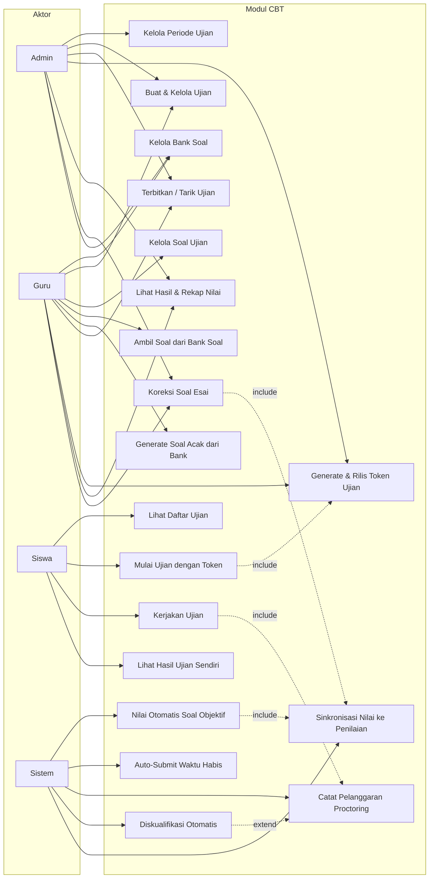

### Deskripsi Use Case

| ID | Use Case | Aktor | Deskripsi |
|----|----------|-------|-----------|
| UC1 | Kelola Periode Ujian | Admin | CRUD periode (UTS/UAS/USBK) per tahun ajaran; dipakai validasi jadwal ujian besar |
| UC2 | Kelola Bank Soal | Admin, Guru | CRUD BankSoal + BankOpsiSoal per mata pelajaran (topik, tingkat kesulitan) |
| UC3 | Buat & Kelola Ujian | Admin, Guru | Buat ujian (kategori, jadwal, durasi, aturan acak/proctoring); hapus diblokir bila sudah dikerjakan |
| UC4 | Kelola Soal Ujian | Guru | CRUD Soal + OpsiSoal per ujian; ubah/hapus diblokir bila ujian sudah dikerjakan |
| UC5 | Ambil Soal dari Bank Soal | Guru | Salin snapshot soal terpilih dari bank ke ujian |
| UC6 | Generate Soal Acak dari Bank | Guru | Ambil N soal acak by kriteria (tipe/topik/kesulitan) lalu salin ke ujian |
| UC7 | Terbitkan / Tarik Ujian | Admin, Guru | Ubah status draft ↔ terbit (syarat: minimal 1 soal) |
| UC8 | Generate & Rilis Token Ujian | Admin, Guru | Buat token 6 karakter; rilis/tahan gerbang pengerjaan |
| UC9 | Lihat Hasil & Rekap Nilai | Admin, Guru | Rekap per siswa + detail koreksi per pengerjaan |
| UC10 | Koreksi Soal Esai | Admin, Guru | Beri skor esai (0–poin); picu hitung ulang nilai |
| UC11 | Lihat Daftar Ujian | Siswa | Daftar ujian terbit untuk kelasnya + status pengerjaan |
| UC12 | Mulai Ujian dengan Token | Siswa | Validasi token, jendela jadwal, sisa attempt → buat sesi |
| UC13 | Kerjakan Ujian | Siswa | Jawab soal (acak deterministik), timer, simpan jawaban per soal |
| UC14 | Lihat Hasil Ujian Sendiri | Siswa | Nilai hanya bila `tampilkan_hasil=true` (nilai tidak dikirim ke browser bila false) |
| UC15 | Nilai Otomatis Soal Objektif | Sistem | Nilai pg/multi/benar_salah/isian saat finalisasi |
| UC16 | Auto-Submit Waktu Habis | Sistem | Finalisasi status `auto_submit` saat `batas_at` tercapai |
| UC17 | Catat Pelanggaran Proctoring | Sistem | blur, exit_fullscreen, tanpa_fullscreen → increment counter |
| UC18 | Diskualifikasi Otomatis | Sistem | Finalisasi status `diskualifikasi` bila pelanggaran ≥ ambang |
| UC19 | Sinkronisasi Nilai ke Penilaian | Sistem | Tulis `nilai_total` ke DetailPenilaian bila semua esai terkoreksi |

---

## 2. Diagram Kelas

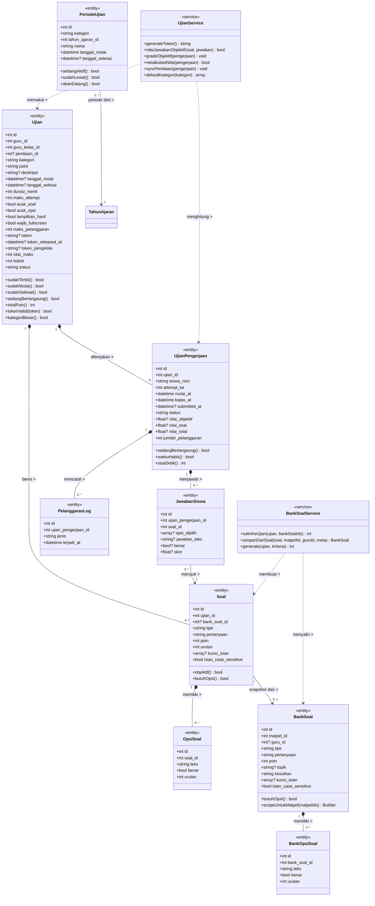

### Catatan Relasi (notasi OMG)

| Relasi | Jenis | Multiplicity | Keterangan |
|--------|-------|--------------|------------|
| Ujian → Soal | Komposisi | 1 → 0..* | Soal hidup-mati bersama ujian |
| Soal → OpsiSoal | Komposisi | 1 → 0..* | Opsi hidup-mati bersama soal |
| BankSoal → BankOpsiSoal | Komposisi | 1 → 0..* | Opsi bank hidup-mati bersama bank soal |
| Ujian → UjianPengerjaan | Komposisi | 1 → 0..* | Sesi milik ujian |
| UjianPengerjaan → JawabanSiswa | Komposisi | 1 → 0..* | Jawaban milik sesi |
| UjianPengerjaan → PelanggaranLog | Komposisi | 1 → 0..* | Log milik sesi |
| Soal → BankSoal | Asosiasi (snapshot) | 0..* → 0..1 | `bank_soal_id` nullable; salinan, bukan referensi hidup |
| JawabanSiswa → Soal | Asosiasi | 0..* → 1 | Jawaban merujuk soal yang dijawab |
| PeriodeUjian → TahunAjaran | Asosiasi | 0..* → 1 | Periode milik satu tahun ajaran |

**Nilai enumerasi penting:**
- `Ujian.status`: `draft`, `terbit`
- `Ujian.kategori`: `kuis`, `uts`, `uas`, `usbk`
- `Soal.tipe` / `BankSoal.tipe`: `pg`, `multi`, `benar_salah`, `isian`, `esai`
- `UjianPengerjaan.status`: `berlangsung`, `selesai`, `auto_submit`, `diskualifikasi`
- `PelanggaranLog.jenis`: `blur`, `exit_fullscreen`, `tanpa_fullscreen`

---
## 3. Diagram Sekuens

### 3.1 Siswa Mulai & Kerjakan Ujian

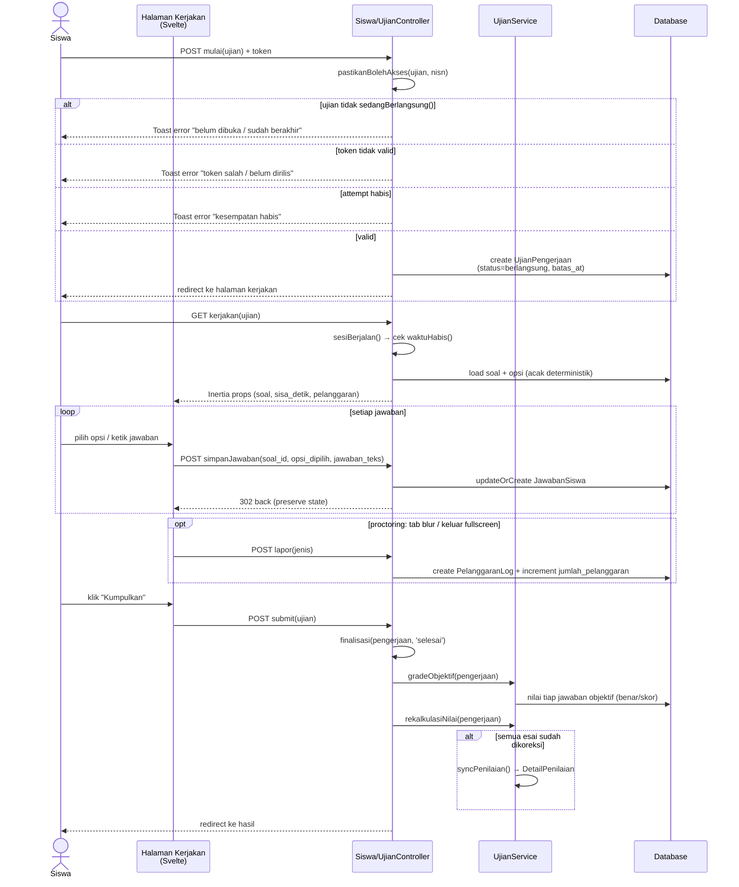

### 3.2 Auto-Submit: Waktu Habis & Pelanggaran Melebihi Ambang

```mermaid
sequenceDiagram
    actor S as Siswa
    participant FE as Halaman Kerjakan<br/>(Svelte + timer)
    participant C as Siswa/UjianController
    participant Svc as UjianService
    participant DB as Database

    alt skenario A — waktu habis
        FE->>FE: timer sisaDetik mencapai 0
        FE->>C: POST submit(ujian) [auto=true]
        C->>C: finalisasi(pengerjaan, 'auto_submit')
    else skenario B — pelanggaran melebihi ambang
        FE->>C: POST lapor(jenis=blur)
        C->>DB: create PelanggaranLog
        C->>DB: increment jumlah_pelanggaran
        alt jumlah_pelanggaran >= maks_pelanggaran
            C->>C: finalisasi(pengerjaan, 'diskualifikasi')
            C-->>S: Toast error "melewati batas pelanggaran"
        end
    end

    C->>Svc: gradeObjektif(pengerjaan)
    loop tiap JawabanSiswa bertipe objektif
        Svc->>Svc: nilaiJawabanObjektif(soal, jawaban)
        Svc->>DB: update benar, skor
    end
    C->>Svc: rekalkulasiNilai(pengerjaan)
    Note over Svc: esai tanpa jawaban = 0 (bukan pending);<br/>esai dijawab tapi belum dikoreksi = pending
    alt nilai_total lengkap
        Svc->>DB: updateOrCreate DetailPenilaian
    else masih ada esai pending
        Svc->>DB: nilai_total = null (menunggu koreksi)
    end
    C->>DB: update UjianPengerjaan<br/>(status, submitted_at, nilai_*)
```

### 3.3 Guru Koreksi Esai & Sinkronisasi Nilai

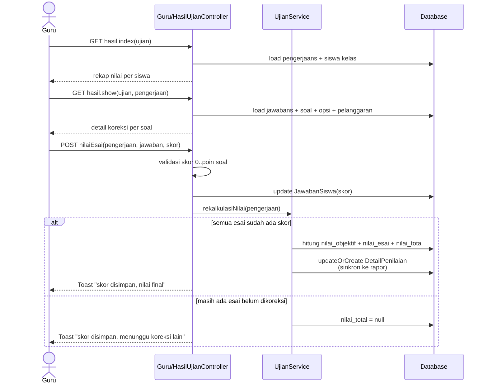

### 3.4 Guru Buat Ujian dari Bank Soal

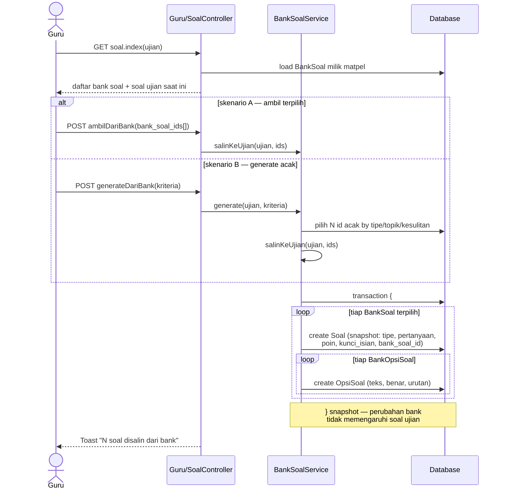

---
## 4. Diagram Aktivitas

### 4.1 Alur Pengerjaan Ujian — Siswa

```mermaid
flowchart TD
    START((Mulai)) --> LOGIN[Login sebagai Siswa]
    LOGIN --> LIHAT[Buka daftar ujian]
    LIHAT --> PILIH{Pilih ujian}
    PILIH --> CEK_JADWAL{Ujian sedang<br/>berlangsung?}
    CEK_JADWAL -- Tidak --> TOLAK_JADWAL[Tampilkan pesan<br/>belum dibuka / berakhir]
    TOLAK_JADWAL --> END1((Selesai))
    CEK_JADWAL -- Ya --> CEK_TOKEN{Butuh token?}
    CEK_TOKEN -- Ya --> INPUT_TOKEN[Input token]
    INPUT_TOKEN --> VALID_TOKEN{Token valid<br/>& sudah dirilis?}
    VALID_TOKEN -- Tidak --> TOLAK_TOKEN[Pesan token salah]
    TOLAK_TOKEN --> END1
    CEK_TOKEN -- Tidak --> CEK_ATTEMPT
    VALID_TOKEN -- Ya --> CEK_ATTEMPT{Sisa attempt?}
    CEK_ATTEMPT -- Tidak --> TOLAK_ATTEMPT[Pesan kesempatan habis]
    TOLAK_ATTEMPT --> END1
    CEK_ATTEMPT -- Ya --> BUAT_SESI[Buat sesi pengerjaan<br/>status=berlangsung]

    BUAT_SESI --> FULLSCREEN{Ujian wajib<br/>fullscreen?}
    FULLSCREEN -- Ya --> GATE[Tampilkan gate fullscreen]
    GATE --> KLIK{Klik masuk<br/>fullscreen?}
    KLIK -- Ya --> KERJAKAN
    KLIK -- Tidak --> CATAT_BYPASS[Catat pelanggaran<br/>tanpa_fullscreen]
    CATAT_BYPASS --> KERJAKAN[Mulai mengerjakan soal]
    FULLSCREEN -- Tidak --> KERJAKAN

    KERJAKAN --> JAWAB[Jawab soal satu per satu<br/>simpan otomatis per soal]
    JAWAB --> PAR{Paralel}
    PAR --> TIMER[Timer berjalan<br/>tampilkan sisa waktu]
    PAR --> AWASI[Awasi proctoring:<br/>blur / keluar fullscreen]

    AWASI --> LANGGAR{Ada pelanggaran?}
    LANGGAR -- Ya --> CATAT[Catat PelanggaranLog<br/>increment counter]
    CATAT --> CEK_AMBANG{Melebihi ambang?}
    CEK_AMBANG -- Ya --> DISKUALIFIKASI[Finalisasi:<br/>status=diskualifikasi]
    DISKUALIFIKASI --> NILAI_OTOMATIS
    CEK_AMBANG -- Tidak --> JAWAB
    LANGGAR -- Tidak --> JAWAB

    TIMER --> WAKTU_HABIS{Waktu habis?}
    WAKTU_HABIS -- Ya --> AUTO_SUBMIT[Finalisasi:<br/>status=auto_submit]
    AUTO_SUBMIT --> NILAI_OTOMATIS[Nilai otomatis<br/>soal objektif]
    WAKTU_HABIS -- Tidak --> KUMPUL{Siswa klik<br/>kumpulkan?}
    KUMPUL -- Tidak --> JAWAB
    KUMPUL -- Ya --> SUBMIT_MANUAL[Finalisasi:<br/>status=selesai]
    SUBMIT_MANUAL --> NILAI_OTOMATIS

    NILAI_OTOMATIS --> HITUNG[Hitung nilai_objektif<br/>+ nilai_esai bila lengkap]
    HITUNG --> ADA_ESAI_PENDING{Ada esai belum<br/>dikoreksi?}
    ADA_ESAI_PENDING -- Ya --> TUNGGU[Nilai total = null<br/>menunggu koreksi guru]
    TUNGGU --> GURU_KOREKSI[Guru koreksi esai]
    GURU_KOREKSI --> HITUNG
    ADA_ESAI_PENDING -- Tidak --> SINKRON[Sinkron ke DetailPenilaian]
    SINKRON --> LIHAT_HASIL{Siswa boleh lihat<br/>tampilkan_hasil?}
    LIHAT_HASIL -- Ya --> TAMPIL_NILAI[Tampilkan nilai]
    LIHAT_HASIL -- Tidak --> SEMBUNYI[Nilai disembunyikan]
    TAMPIL_NILAI --> END2((Selesai))
    SEMBUNYI --> END2
```

### 4.2 Alur Koreksi — Guru

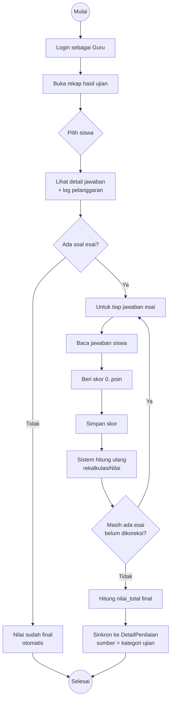

---
## 5. Diagram State Machine

### 5.1 Status Ujian

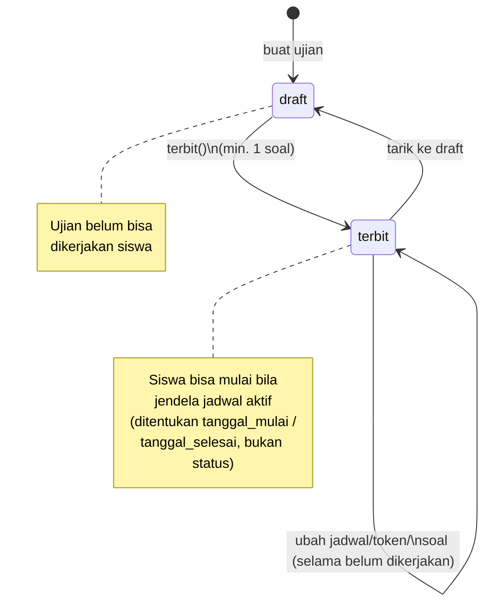

### 5.2 Status UjianPengerjaan

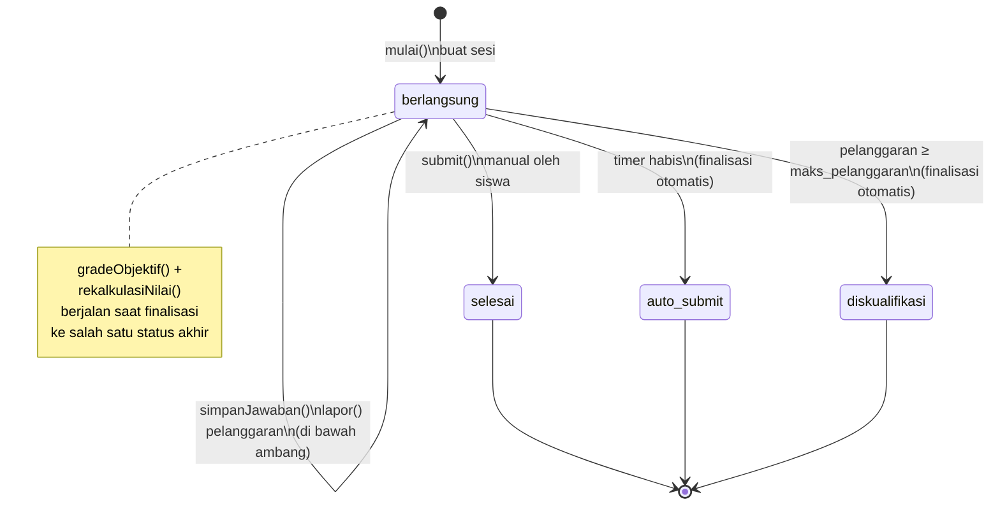

**Aturan transisi penting:**
- `berlangsung` → status akhir bersifat **final** (tidak bisa kembali).
- Guard edit soal: `SoalController@update/destroy` ditolak bila `ujian.pengerjaans()->exists()`.
- Guard hapus ujian: `UjianController@destroy` ditolak bila sudah ada pengerjaan.
- Esai tanpa jawaban (`JawabanSiswa` tidak ada) dihitung **0**, bukan pending — nilai tidak macet.

---
## 6. BPMN 2.0 — Proses Bisnis Modul CBT

> Notasi: diagram digambar sebagai flowchart Mermaid dengan **pool** (subgraph) per partisipan mengikuti semantik BPMN 2.0 OMG — start/end event (lingkaran), task (persegi), exclusive gateway (diamond `X`), parallel gateway (diamond `+`), message flow (panah putus-putus antar pool), sequence flow (panah solid dalam pool).

### 6.1 Proses Pelaksanaan Ujian

Kolaborasi tiga pool: **Guru (Pengawas)**, **Siswa**, **Sistem**.

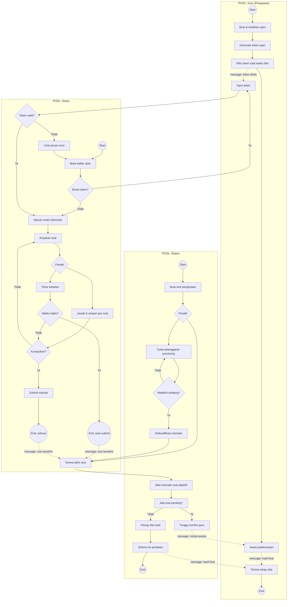

### 6.2 Proses Penilaian & Koreksi

Kolaborasi dua pool: **Guru**, **Sistem**.

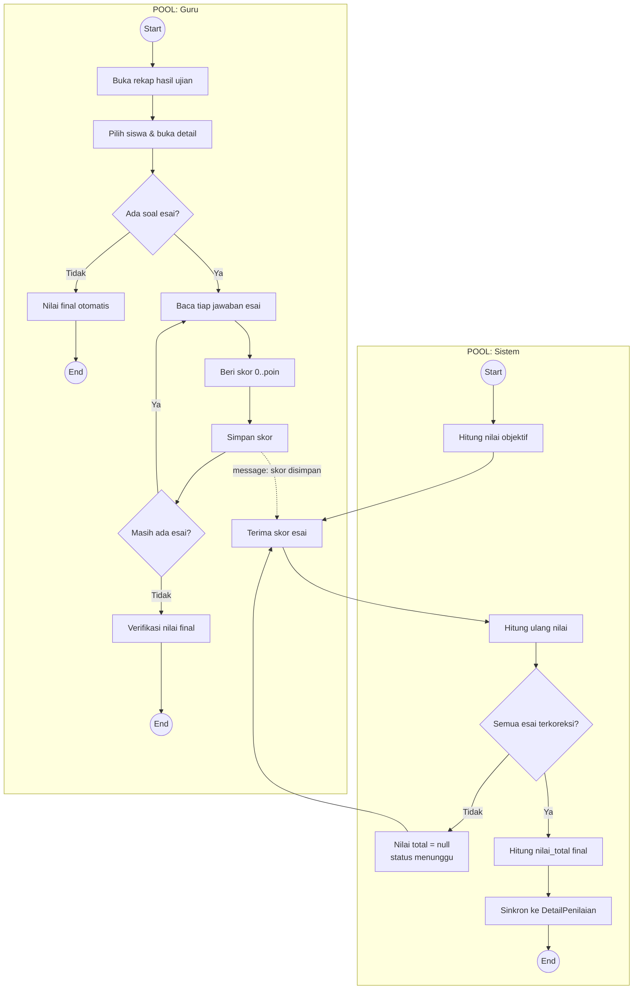

### 6.3 Proses Pengelolaan Bank Soal

Kolaborasi dua pool: **Guru**, **Admin**.

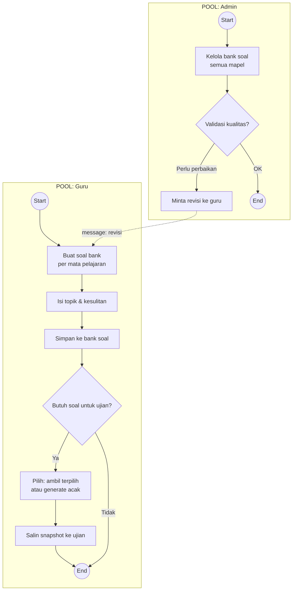

### Legenda Elemen BPMN

| Simbol Mermaid | Elemen BPMN 2.0 |
|---|---|
| `(( ))` | Start / End Event |
| `[ ]` | Task (aktivitas) |
| `{ }` | Exclusive Gateway (XOR) |
| `{Paralel}` | Parallel Gateway (AND) |
| `-.->` antar subgraph | Message Flow antar pool |
| `-->` dalam subgraph | Sequence Flow dalam pool |

---

## Referensi Silang

- Modul non-CBT: `docs/uml/00-index.md` s.d. `docs/uml/08-deployment.md`, `docs/UML-APLIKASI.md`
- Kode sumber: `app/Models/Ujian.php`, `app/Models/Soal.php`, `app/Models/UjianPengerjaan.php`, `app/Models/JawabanSiswa.php`, `app/Models/PelanggaranLog.php`, `app/Models/BankSoal.php`, `app/Models/PeriodeUjian.php`, `app/Services/UjianService.php`, `app/Services/BankSoalService.php`
- Controller: `app/Http/Controllers/{Admin,Guru,Siswa}/UjianController.php`, `Guru/{SoalController,BankSoalController,HasilUjianController}.php`

*Dokumen ini dibuat berdasarkan kode sumber pada branch `redesign-dashboard` dan mengikuti OMG UML 2.5.1 serta OMG BPMN 2.0.*
